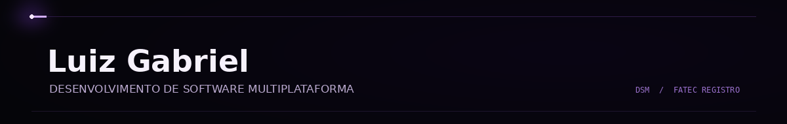
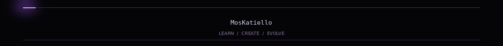

  

  

  
  
  

 

  

  19 anos | Ilha Comprida, São Paulo | Estudante de Desenvolvimento de Software Multiplataforma na FATEC Registro

  
  
  

---

## Animação de contribuições

  

---

## Projeto em destaque

### MEC — Mentes em Códigos

Serious game 2D no estilo RPG/plataforma, acompanhado de uma plataforma web, criado para ensinar **Programação Orientada a Objetos (POO)** de forma prática e interativa.

Tecnologias relacionadas ao projeto:

  
  
  
  

[Ver todos os meus projetos no GitHub](https://github.com/MosKatiello?tab=repositories)

---

## Tecnologias e ferramentas

Clique em cada tecnologia para abrir o repositório, a ferramenta ou a documentação correspondente.

  
  &nbsp;&nbsp;
  
  &nbsp;&nbsp;
  
  &nbsp;&nbsp;
  
  &nbsp;&nbsp;
  

  
  
  
  
  

  O Figma direciona para o site oficial porque ainda não foi fornecido um link de perfil ou arquivo pessoal nessa plataforma.

---

## Repositórios de estudo

| Área | Repositório |
|---|---|
| Desenvolvimento Web I | [Dw1-FATEC-REGISTRO](https://github.com/MosKatiello/Dw1-FATEC-REGISTRO) |
| Banco de Dados | [BANCO-DE-DADOS](https://github.com/MosKatiello/BANCO-DE-DADOS) |
| Algoritmos | [ALGORITMO](https://github.com/MosKatiello/ALGORITMO) |
| Design Digital | [D.DIGITAL](https://github.com/MosKatiello/D.DIGITAL) |
| Engenharia de Software | [ENGENHARIA-DE-SOFTWARE](https://github.com/MosKatiello/ENGENHARIA-DE-SOFTWARE) |
| Sistemas Operacionais e Redes de Computadores | [SORC](https://github.com/MosKatiello/SORC) |

---

## Em que estou focado

- **Desenvolvimento Web:** estruturação de páginas com HTML e estilização com CSS.
- **Versionamento de Código:** organização e gerenciamento de projetos utilizando Git e GitHub.
- **UI/UX Design:** prototipação e criação de interfaces com Figma.
- **Formação:** Desenvolvimento de Software Multiplataforma (DSM) na FATEC Registro.

---

## Contato

  
  
  

  Obrigado por visitar meu perfil.

  

