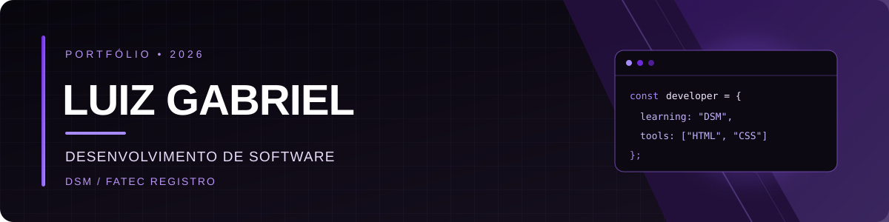

01 · Projeto em destaque
<table>
  <tr>
    <td>
      <h3>🎮 MEC — Mentes em Códigos</h3>
      
Serious game 2D no estilo RPG/plataforma, acompanhado de uma plataforma web, criado para ensinar <strong>Programação Orientada a Objetos (POO)</strong> de maneira prática e interativa.

      
      
      
      
    </td>
  </tr>
</table>02 · Tecnologias & ferramentas

  

03 · Em desenvolvimento
Área	Foco
Front-end	Estruturação de páginas com HTML e estilização com CSS
Versionamento	Organização de projetos com Git e GitHub
UI/UX	Prototipação e criação de interfaces no Figma
Formação	Desenvolvimento de Software Multiplataforma — FATEC Registro

04 · GitHub em números

05 · Animação das contribuições

  

Vamos nos conectar?

<i>Construindo, aprendendo e evoluindo a cada linha de código.</i>

  

<i>“Construindo, aprendendo e evoluindo a cada linha de código.”</i>

